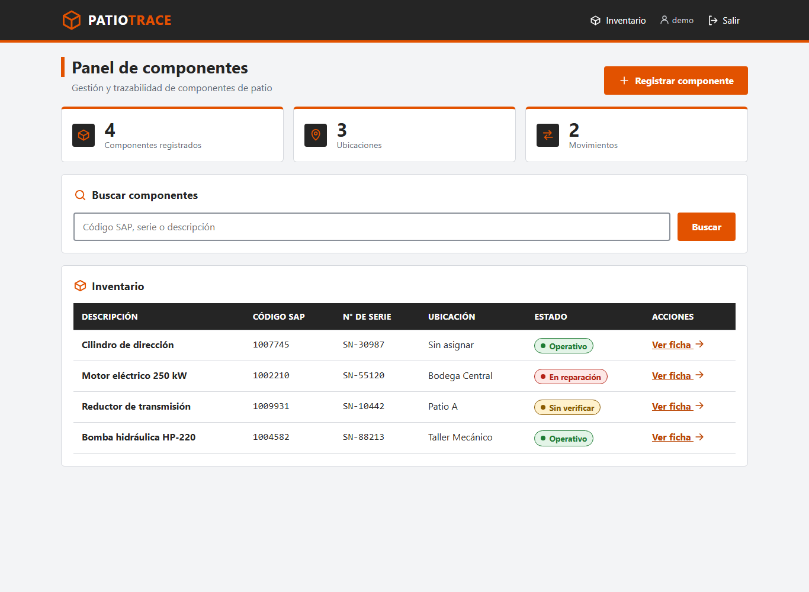
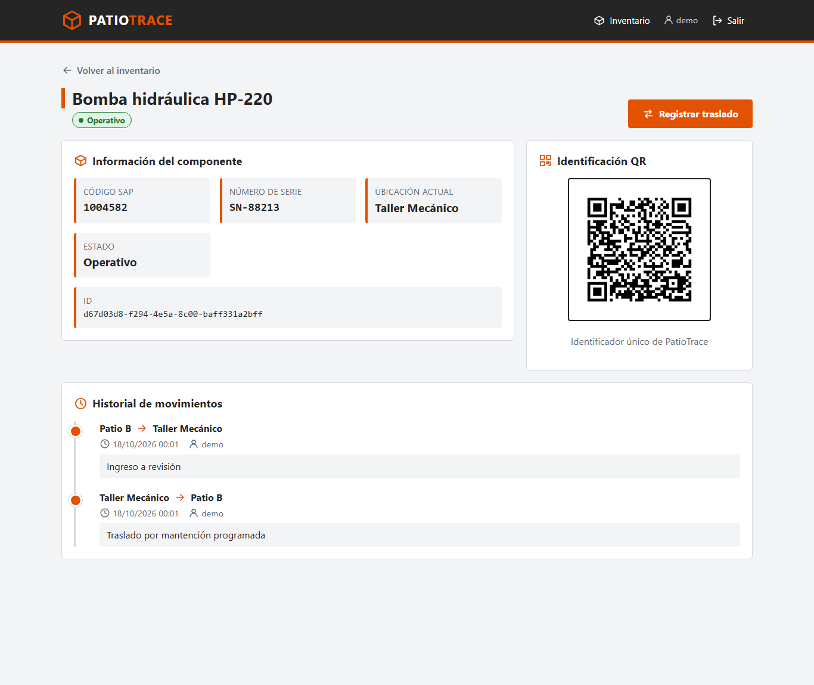
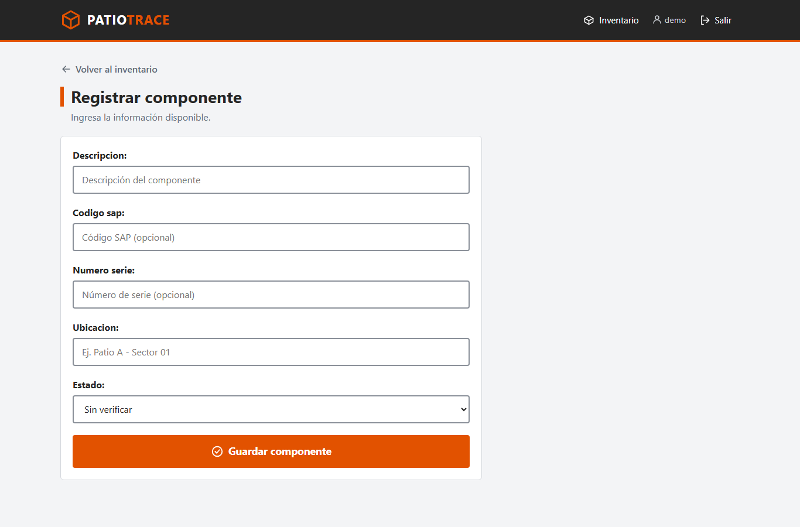
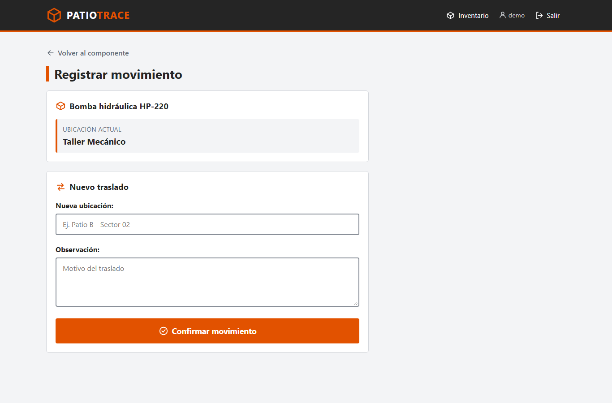
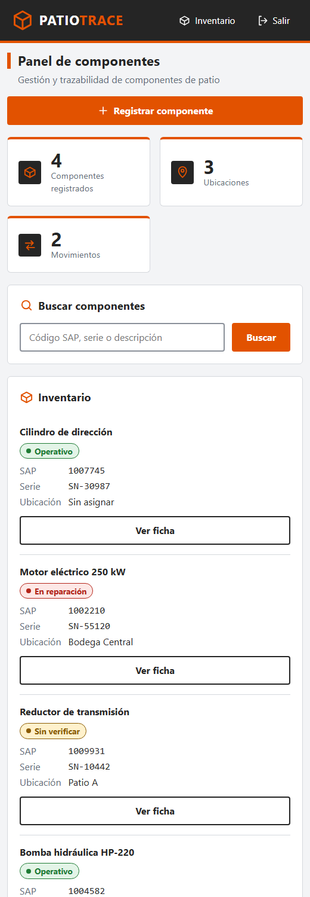

# PatioTrace

Aplicación web en Django para la gestión y trazabilidad de componentes de patio en una operación minera. Permite registrar componentes, identificarlos con un código QR, controlar su ubicación y consultar el historial de movimientos.

> Proyecto independiente. La interfaz se inspira en una paleta industrial en naranja y grafito, pero no usa logotipos oficiales ni representa un producto corporativo autorizado.

## Capturas

### Panel de inventario (escritorio)



### Ficha del componente, QR e historial



### Registro de componente



### Registro de movimiento



### Vista móvil / terminal Zebra



## Funcionalidades

- Panel con resumen de componentes, ubicaciones y movimientos.
- Inventario con búsqueda por código SAP, número de serie o descripción.
- Estados diferenciados por color (operativo, sin verificar, en reparación).
- Ficha del componente con código SAP, serie, ubicación, estado y QR.
- Traslados entre ubicaciones con historial (origen, destino, fecha, usuario y observaciones).
- Permisos de Django para registrar componentes y movimientos.
- Diseño responsivo para computadores, tablets y dispositivos Zebra con navegador.

## Requisitos

- Python 3.13
- Dependencias de `requirements.txt` (Django, qrcode, Pillow)

## Instalación

```powershell
python -m venv .venv
.\.venv\Scripts\Activate.ps1
pip install -r requirements.txt
python manage.py migrate
python manage.py createsuperuser
python manage.py runserver
```

Abre `http://127.0.0.1:8000/` e inicia sesión con el usuario creado (el acceso redirige a `/admin/login/`).

## Rutas

| Ruta | Descripción |
| --- | --- |
| `/` | Panel e inventario |
| `/registrar/` | Registrar componente |
| `/detalle/<uuid>/` | Ficha del componente |
| `/qr/<uuid>/` | Imagen PNG del código QR |
| `/movimiento/<uuid>/` | Registrar traslado |

## Estructura

```
componentes/
  static/componentes/patiotrace.css   Estilos centralizados
  templates/componentes/              Plantillas (base, inicio, detalle, formularios)
config/                               Configuración del proyecto Django
docs/screenshots/                     Capturas usadas en este README
```

## Diseño

| Uso | Color |
| --- | --- |
| Acento / botones | `#E25200` |
| Hover | `#BA4300` |
| Barra y texto | `#252525` |
| Fondo | `#F3F4F6` |
| Texto secundario | `#626B76` |

Botones y campos de al menos 44 px para pantallas táctiles, foco visible y sin animaciones.
